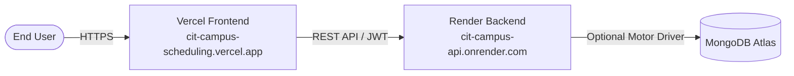

# 🚀 Deployment Guide: Vercel & Render

This guide walks you through deploying the **CIT Campus Scheduling Platform** to production:
- **Frontend (React + Vite)**: Deployed on **[Vercel](https://vercel.com)**
- **Backend (FastAPI + OR-Tools)**: Deployed on **[Render](https://render.com)**
- **Database (Optional)**: Free **[MongoDB Atlas](https://www.mongodb.com/atlas)** M0 cluster (falls back automatically to in-memory storage if omitted)

---

## 🏗️ Architecture Overview



---

## Part 1: Deploy Backend on Render

Deploy the FastAPI backend first so you have your production API URL ready for Vercel.

### Option A: Using Render Blueprint (`render.yaml`) — Recommended

1. Log into your **[Render Dashboard](https://dashboard.render.com/)**.
2. Click **New +** and select **Blueprint**.
3. Connect your GitHub repository: `Yash-kumar147/cit-campus-scheduling`.
4. Render will automatically detect `render.yaml` and configure the `cit-campus-api` Web Service on the **Free** tier.
5. Provide your environment variables when prompted:
   - `MONGODB_URI`: (Optional) Your MongoDB Atlas connection string.
   - `GEMINI_API_KEY`: (Optional) For AI Hinglish natural language parsing.
6. Click **Apply**. Render will build and deploy the container.
7. Copy your backend URL: `https://cit-campus-api-xxxx.onrender.com`.

---

### Option B: Manual Web Service Setup (Free Tier)

1. In **[Render Dashboard](https://dashboard.render.com/)**, click **New +** → **Web Service**.
2. Connect `Yash-kumar147/cit-campus-scheduling`.
3. Fill in the service configuration:
   - **Name**: `cit-campus-api`
   - **Region**: Oregon (US West) or Frankfurt (EU)
   - **Branch**: `main`
   - **Root Directory**: Leave blank (root `./`)
   - **Runtime**: **Docker** (recommended) or **Python 3**
     - If using **Docker**:
       - Dockerfile Path: `backend/Dockerfile`
       - Docker Context: `.`
     - If using **Python 3**:
       - Build Command: `pip install -r backend/requirements.txt`
       - Start Command: `uvicorn app.main:app --app-dir backend --host 0.0.0.0 --port $PORT`
   - **Instance Type**: **Free**
4. Under **Environment Variables**, add:
   | Key | Value | Notes |
   | --- | --- | --- |
   | `ENVIRONMENT` | `production` | Enables production mode |
   | `PORT` | `8000` | Render dynamically binds to `$PORT` |
   | `JWT_SECRET` | `cit_production_jwt_secret_change_me_32char` | Secure random key |
   | `MONGODB_URI` | `mongodb+srv://...` | Optional; in-memory fallback if omitted |
   | `MONGODB_DB_NAME` | `cit_scheduling` | Database name |
   | `GEMINI_API_KEY` | *(your key)* | Optional for AI Assistant |
   | `SOLVER_TIME_LIMIT_SEC` | `40` | CP-SAT solver budget |
   | `SOLVER_NUM_WORKERS` | `2` | Number of CP-SAT worker threads |
   | `CORS_ORIGINS` | `http://localhost:5173` | Vercel domains are allowed automatically |
5. Click **Create Web Service**.
6. When deployment finishes, test the health check in your browser:
   ```bash
   https://<your-render-subdomain>.onrender.com/api/v1/health/ready
   ```
   It should return `{"status":"ready","database":"...","active_schedule_loaded":true}`.

---

## Part 2: Deploy Frontend on Vercel

1. Log into your **[Vercel Dashboard](https://vercel.com/dashboard)**.
2. Click **Add New...** → **Project**.
3. Import your GitHub repository: `Yash-kumar147/cit-campus-scheduling`.
4. Configure the project:
   - **Framework Preset**: `Vite`
   - **Root Directory**: Click `Edit` and select `frontend` (or leave as root `./` — both are supported via root `vercel.json`).
   - **Build Command**: `npm run build`
   - **Output Directory**: `dist`
5. Expand **Environment Variables** and add:
   | Key | Value | Description |
   | --- | --- | --- |
   | `VITE_API_URL` | `https://<your-render-subdomain>.onrender.com` | Your live Render backend URL |

   > **Note**: Do not include a trailing slash in `VITE_API_URL` (e.g. `https://cit-campus-api.onrender.com`).

6. Click **Deploy**.
7. Vercel will install dependencies, build the TypeScript bundle, and assign your domain:
   ```
   https://cit-campus-scheduling.vercel.app
   ```

---

## Part 3: Deploy with Docker Compose (Single VM / VPS / Local Production)

For on-premises, AWS EC2, DigitalOcean Droplet, or local production testing:

```bash
# Clone the repository
git clone https://github.com/Yash-kumar147/cit-campus-scheduling.git
cd cit-campus-scheduling

# Build and start all services in detached mode
docker compose up --build -d
```

This automatically orchestrates:
- **`cit_backend`**: FastAPI on `http://localhost:8000` with automated healthchecks
- **`cit_frontend`**: React 18 production build served by Nginx on `http://localhost:80` (and `http://localhost:5173`)
- **`cit_mongo`**: MongoDB 7.0 with persistent storage volume on port `27017`

To view logs:
```bash
docker compose logs -f
```

To stop:
```bash
docker compose down
```

---

## Part 4: Alternative PaaS (Railway & Netlify)

### Backend on Railway
1. Click **New Project** → **Deploy from GitHub repo**.
2. Select repository. Railway automatically detects `railway.json` and `Dockerfile`.
3. Add environment variables (`JWT_SECRET`, `ENVIRONMENT=production`, `MONGODB_URI`).
4. Generate domain and copy your backend URL.

### Frontend on Netlify
1. Connect repository in Netlify dashboard.
2. Netlify automatically reads `netlify.toml` (`base = "frontend"`, `publish = "dist"`).
3. Set environment variable: `VITE_API_URL=https://<your-backend-domain>`.
4. Click **Deploy Site**.

---

## Part 5: Verification & Smoke Test

Once both are deployed:

1. Open your live Vercel frontend in your browser.
2. Test Demo Accounts:
   - Click **Admin** to view full analytics, room utilization, and pending approvals.
   - Click **Deputy Coordinator** to verify access to **Conflict Reports** with the badge.
   - Switch to **Faculty** or **Club Rep** and verify **Conflict Reports** shows **Access Restricted**.
3. Test Approvals Flow:
   - In the **Dashboard**, approve pending requests.
   - Verify the pending approvals section remains empty until a new request is submitted.
4. Test AI Booking:
   - Navigate to **Spectra Venue Booking** or **AI Assistant**.
   - Type a Hinglish or English prompt (e.g., `"Kal sham 4 baje seminar hall chahiye 100 logon ke liye"`).
   - Verify slot parsing and conflict-free booking proposal generation.

---

## 🛠️ Troubleshooting & Tips

- **Render Cold Starts (Free Tier)**:
  Render spins down free web services after 15 minutes of inactivity. The first request after sleep may take ~30–45 seconds to wake up.
- **CORS Configuration**:
  The backend is configured with `allow_origin_regex=r"^https://.*\.vercel\.app$"` so all Vercel preview branch deployments and custom subdomains are authorized automatically. If using a custom domain (e.g., `schedule.cit.edu`), add it to `CORS_ORIGINS` in Render.
- **SPA Routing**:
  Client-side routing (`/conflicts`, `/timetable`, `/dashboard`, etc.) is handled via `vercel.json` rewrites to prevent 404s on page refresh.
