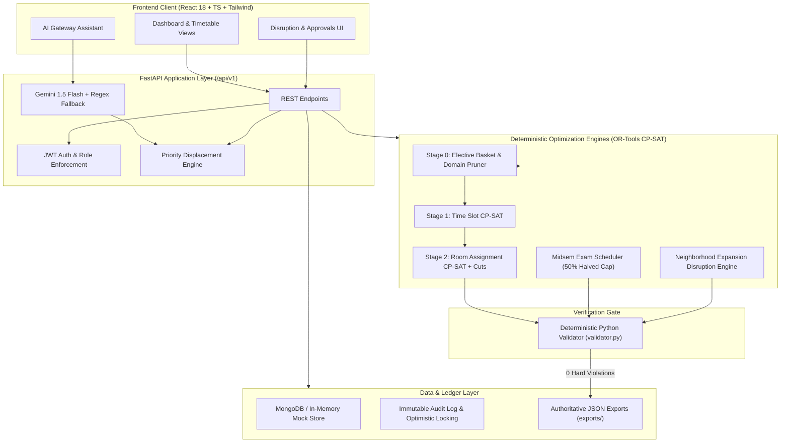

# Chilika Institute of Technology (CIT) Campus Scheduling Platform

[](https://github.com/cit-campus/scheduling-platform/actions/workflows/ci.yml)
[-10b981.svg)](validator.py)
[](https://developers.google.com/optimization)
[](https://fastapi.tiangolo.com)
[](https://react.dev)
[](https://tailwindcss.com)

A high-performance, clash-free academic scheduling, midsem examination timetabling, and venue booking platform engineered for **Chilika Institute of Technology (CIT)**. Powered by **Google OR-Tools CP-SAT constraint programming**, **FastAPI**, **MongoDB**, and **React 18**, with an **AI Gateway** supporting English and Hinglish natural language booking requests.

---

## 1. System Architecture



---

## 2. Mathematical Solver Formulation

The scheduling challenge is formulated as a decomposed two-stage Constraint Satisfaction Problem (CSP) with deterministic feedback cuts:

### Stage 0: Preprocessing & Domain Pruning
- **Elective Basket Alignment:** Courses belonging to common elective baskets (e.g. `BASKET_CS_ELEC_1`) are grouped and constrained to run concurrently in identical time slots.
- **Feasible Candidate Domains:** For each session $s$, candidate slots and rooms are precomputed using room type tags, minimum capacities, ADA accessibility requirements, and scheduled maintenance windows.

### Stage 1: Time Slot Assignment (CP-SAT)
Let $x_{s, t} \in \{0, 1\}$ denote whether session $s$ starts at time slot $t = (d, p)$.
- **Non-overlapping Student Groups:**
  $$\sum_{s \in S_g} \sum_{t' \in \text{overlap}(t, \text{dur}_s)} x_{s, t'} \le 1 \quad \forall g \in \text{Groups}, \forall t$$
- **Faculty Availability & Daily Limits:**
  $$\sum_{s \in S_f} \sum_{t' \in \text{overlap}(t, \text{dur}_s)} x_{s, t'} \le 1 \quad \forall f \in \text{Faculty}, \forall t$$
  $$\sum_{s \in S_f} \sum_{t \in \text{day } d} \text{dur}_s \cdot x_{s, t} \le \text{daily\_limit}_f \quad (\le 4 \text{ hours})$$
- **Lunch Period Invariance:** $x_{s, t} = 0$ for any slot overlapping Period 5 (13:00 – 14:00).
- **3-Hour Lab Block Starts:** Commencing strictly at $p \in \{\text{P2}, \text{P6}\}$.
- **Soft Objective:**
  $$\min \sum 5 \cdot \text{AvoidSlotViolations} + \sum 3 \cdot \text{StudentGaps} + \sum 2 \cdot \text{FacultyRoomSwitches}$$

### Stage 2: Room Assignment (CP-SAT)
Given time assignments from Stage 1, assign room $r$ to session $s$ via $y_{s, r} \in \{0, 1\}$.
- **Room Capacity & Type:** $y_{s, r} = 0$ if $\text{cap}_r < \text{size}_s$ or $\text{type}_r \neq \text{req}_s$.
- **No Room Overlaps:** At any time period, at most 1 session per room.
- **Accessibility:** $y_{s, r} = 0$ if $s.\text{needs\_accessible}$ and not $r.\text{accessible}$.
- **No-Good Cuts:** If Stage 2 finds time assignments infeasible due to room contention, a no-good cut is added to Stage 1 to ban that time combination and re-solve.

### Midsem Exam Scheduling (Anti-Copy Rule)
- For every exam $e$ and room $r$, the effective capacity is strictly halved:
  $$\text{EffectiveCapacity}(r) = \lfloor \text{capacity}(r) / 2 \rfloor$$
- Exams allocated to Lecture Halls (`LH101`, `LH102`, `LH201`, `LH202`) and Auditoriums (`AUD1`).

### Disruption Rescheduling (Minimal Moves)
When a disruption occurs (e.g. room maintenance or faculty absence), the engine freezes unaffected sessions and searches expanding neighbourhoods (Tiers 1 through 4) to resolve conflicts while minimizing total displaced sessions:
$$\min \sum_{s} \mathbb{I}(\text{slot}_s \neq \text{slot}_s^{\text{orig}} \lor \text{room}_s \neq \text{room}_s^{\text{orig}})$$
In our benchmark sample disruption, all 189 sessions + 1 emergency new session were scheduled with **0 hard violations and only 45 moved sessions**.

---

## 3. Spectra Venue Priority Engine

Spectra venue booking requests are evaluated against 6 strict priority tiers:

$$\text{Tier 1: Midsem/Endsem Exams} > \text{Tier 2: Regular Classes/Labs} > \text{Tier 3: Institute Events} > \text{Tier 4: Guest Lectures} > \text{Tier 5: Department Events} > \text{Tier 6: Club Events}$$

- **Displacement:** If an approved booking of lower priority collides with a higher-priority request, the lower-priority booking is automatically displaced.
- **Ranked Alternatives:** The engine computes the top 3 alternative rooms and slots for displaced events matching capacity and features.
- **Same Tier Resolution:** Resolved First-Come First-Served (FCFS); no displacement is permitted.
- **Self-Approval Prohibition:** A requester cannot approve their own booking; requests must be ratified by an independent administrator or coordinator.

---

## 4. Benchmark Dataset & Results

| Entity | Count | Notes |
| :--- | :--- | :--- |
| **Venues / Rooms** | **27** | 4 Lecture Halls, 16 Laboratories, 5 Seminar Halls, 1 Auditorium, 1 Amphitheatre |
| **Faculty Members** | **40** | Teaching cap max 4h/day, unavailable slots, soft avoid preferences |
| **Student Cohorts** | **14** | Year 1 to 4 across CSE, ECE, ME, CE |
| **Courses** | **62** | Theory, 3-hour labs, elective baskets |
| **Weekly Teaching Sessions** | **189** | 243 instructional hours across 5 days (Mon–Fri, P1–P9) |
| **Midsem Exams** | **41** | Halved room capacity rule strictly observed |
| **Spectra Booking Requests** | **25** | Prioritized and scheduled without class clashes |
| **Official Validator Status** | **0 Violations** | **VALID (PASSED)** across all 13 hard constraints |

---

## 5. Demo Accounts

The platform includes 4 pre-configured demo personas with 1-click Quick Login buttons in the UI:

| Persona | Role | Email | Password | Permissions & Workflow |
| :--- | :--- | :--- | :--- | :--- |
| **Dean (Academic)** | `admin` | `admin@cit.edu` | `Admin@123` | Full administrative control: generate timetables, approve disruption proposals with optimistic locks, trigger demo resets. |
| **Dept Coordinator** | `coordinator` | `coord@cit.edu` | `Coord@123` | Department event requests, independent booking reviews, view faculty availability matrix. |
| **Faculty Member** | `faculty` | `faculty@cit.edu` | `Faculty@123` | Dr. Arvind Sharma (Basic Sciences): view teaching schedule, request lecture halls, report leave availability. |
| **Club Representative** | `club_rep` | `club@cit.edu` | `Club@123` | Cultural Council representative: request Spectra venues using English or Hinglish AI Assistant. |

---

## 6. Quickstart Guide

### Prerequisites
- Python 3.12+ (with CPython `win_amd64` or Linux x86_64)
- Node.js 20+ and npm
- (Optional) MongoDB 6+ running locally on port 27017 (Platform automatically falls back to high-fidelity In-Memory store if MongoDB is not present)

### 1. Setup Backend
```bash
# Clone the repository
git clone https://github.com/cit-campus/scheduling-platform.git
cd scheduling-platform

# Create and activate Python virtual environment
python -m venv .venv
# On Windows:
.venv\Scripts\activate
# On Linux / macOS:
source .venv/bin/activate

# Install backend dependencies
pip install -r backend/requirements.txt

# Start FastAPI server on port 8000
uvicorn app.main:app --app-dir backend --reload --port 8000
```
FastAPI interactive Swagger docs will be accessible at: `http://localhost:8000/docs`

### 2. Setup Frontend
```bash
cd frontend

# Install dependencies
npm install

# Run Vite development server
npm run dev
```
Open your browser at: `http://localhost:5173`

### 3. Verify Validator & Official Exports
Run the official validator against baseline and disruption outputs:
```bash
# Validate baseline schedule (189 sessions, 41 exams)
python validator.py --schedule exports/schedule.json --dataset data/cit_public.json

# Validate disruption rescheduled schedule (with before diff)
python validator.py --schedule exports/schedule_after.json --dataset data/cit_public.json --before exports/schedule.json --disruption data/sample_disruption.json

# Run end-to-end regression validation script
python scripts/validate_export.py
```

### 4. Run Pytest Test Suite
```bash
pytest backend/tests/ -v
```

---


## 7. Repository Structure

```
├── .github/
│   └── workflows/
│       └── ci.yml                 # GitHub Actions CI (lint, tests, validator regression, frontend build)
├── backend/
│   ├── app/
│   │   ├── ai/
│   │   │   └── gateway.py         # Gemini 1.5 Flash + Regex fallback parser
│   │   ├── api/
│   │   │   └── routes.py          # All 20 /api/v1 REST endpoints
│   │   ├── db/
│   │   │   └── mongo.py           # Motor async connector + In-Memory mock store
│   │   ├── rules/
│   │   │   ├── candidates.py      # Room and slot domain candidate generator
│   │   │   ├── conflicts.py       # Pure Python conflict detector
│   │   │   ├── priority.py        # 6-tier venue priority and displacement logic
│   │   │   └── time_grid.py       # Campus time grid, periods P1-P9, lunch P5
│   │   ├── schemas/
│   │   │   └── all_schemas.py     # Pydantic v2 schemas
│   │   ├── services/
│   │   │   ├── auth.py            # Bcrypt hashing, JWT tokens, RBAC dependencies
│   │   │   └── bookings.py        # Booking state machine & ranked alternative search
│   │   ├── solver/
│   │   │   ├── engine.py          # Master two-stage CP-SAT coordinator
│   │   │   ├── exams.py           # Midsem exam scheduler (halved room capacity)
│   │   │   ├── preprocess.py      # Elective basket grouping and pruning
│   │   │   ├── reschedule.py      # Minimal-move disruption neighborhood search
│   │   │   ├── stage1_time.py     # Stage 1 CP-SAT time assignment
│   │   │   └── stage2_rooms.py    # Stage 2 CP-SAT room assignment + no-good cuts
│   │   ├── main.py                # FastAPI entrypoint, lifespan, CORS, demo seed
│   │   └── worker.py              # Background worker for solver jobs
│   ├── tests/                     # 17 pytest regression test suites
│   ├── Dockerfile                 # Production backend container definition
│   └── requirements.txt           # Pinned backend dependencies
├── data/
│   ├── cit_public.json            # Official benchmark dataset (27 rooms, 40 faculty, etc.)
│   ├── sample_disruption.json     # Benchmark disruption scenario
│   ├── validator.py               # Deterministic constraint validator
│   └── README.md                  # Dataset specification and CLI documentation
├── exports/
│   ├── schedule.json              # Published baseline schedule (189 sessions, 41 exams)
│   └── schedule_after.json        # Rescheduled schedule post-disruption (45 moves)
├── frontend/
│   ├── src/
│   │   ├── components/            # Layout, Navigation, Role Switcher
│   │   ├── context/               # AuthContext with 1-click Demo Accounts
│   │   ├── pages/                 # 10 Dashboard & Scheduling Views
│   │   ├── api.ts                 # Typed API client
│   │   └── types.ts               # TypeScript data interfaces
│   ├── tailwind.config.js         # Exact CIT theme color tokens (#0D9488, #F5F7FB)
│   ├── vercel.json                # Vercel deployment & API rewrites configuration
│   └── package.json               # Frontend dependencies & scripts
├── scripts/
│   ├── generate_dataset.py        # Dataset generator matching CIT requirements
│   ├── validate_export.py         # End-to-end regression validation script
│   ├── seed_demo.py               # Database seeder for demo accounts & schedules
│   └── smoke.py                   # Health and endpoint smoke testing script
├── validator.py                   # Root authoritative validator CLI
├── render.yaml                    # Render deployment blueprint (API + Worker)
├── .env.example                   # Environment configuration template
├── AI_USAGE.md                    # AI usage, prompt locations, and safety declaration
├── THIRD_PARTY.md                 # Open-source license disclosures
└── README.md                      # Platform documentation and demo video script
```

---

## 8. Known Limitations & Roadmap

1. **Continuous Multi-Week Schedules:** Currently optimized for the standard repeating weekly timetable grid (Monday–Friday) plus midsem exam blocks. Future versions will support multi-semester rotational blocks.
2. **Dynamic Invigilator Roster Optimization:** Midsem exams currently assign venues and cohorts under halved capacity; automated faculty invigilation duty assignment using CP-SAT is scheduled for v2.1.
3. **Real-Time Push Notifications:** Currently utilizes optimistic locking and polling status endpoints; WebSocket notifications via Redis Pub/Sub are planned for high-concurrency event days.

---

## 9. License
Developed for the **Chilika Institute of Technology (CIT)**. Open-source educational platform available under the [MIT License](LICENSE).

